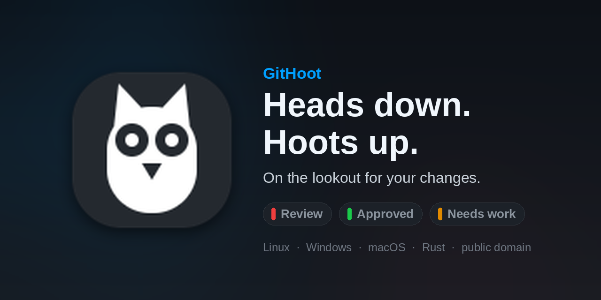

<div align="center">



### Heads down. Hoots up.

An owl in your system tray, on the lookout for your changes on GitHub and GitLab.<br>
It lights up when something needs you, and hoots once when it is news.

[](../../releases/latest)
[](../../actions/workflows/ci.yml)
[](../../releases)
[](LICENSE)


[**Download**](#get-it) · [**What the icon says**](#what-the-icon-says) · [**Settings**](docs/menu-and-settings.md#settings) · [**Deep dives**](#dig-deeper)

</div>

---

## Why

- **Stay in flow.** No tab to refresh, no inbox to sweep. The owl checks GitHub and GitLab for you, at
  least once a minute, so you can keep your head down.
- **Know at a glance.** Three coloured bars on one icon say whether anything is waiting on you. Act on
  it and the bar clears itself.
- **Hear only news.** One hoot when something new needs you, silence the rest of the time. It can tell
  a new pull request from the same one handed back by a flaky search index → [the hoot](docs/hoot.md).

Every lit bar has a menu entry with its count. Clicking one opens **a page GitHoot renders itself**,
listing exactly what that bar counted, with check states and every reviewer's verdict. No forge search
URL can express what two of the three bars count → [the PR page](docs/pr-page.md).

No CLI to install, no token to paste: you sign in with your forge's own device flow, and the code is
already on your clipboard when the dialog appears.

## Get it

| Platform | Asset |
|---|---|
| 🪟 Windows x86-64 | [`githoot.exe`](../../releases/latest) |
| 🐧 Linux x86-64 | [`githoot`](../../releases/latest) |
| 🍎 macOS Apple Silicon | [`githoot-macos-aarch64.zip`](../../releases/latest) |

Or build it:

```bash
cargo build --release          # -> target/release/githoot
```

<details>
<summary><b>First launch, and the two platform footnotes</b></summary>

**The tray icon appears immediately** — it never blocks on a sign-in. If PR status has no credential
yet, the owl wears a red exclamation and the menu offers **Authenticate GitHub PR Status**; pick it
when it suits you. While no portal is signed in, or the GitHub App is installed nowhere, **onboarding**
opens in your browser: sign in, install the [App](https://github.com/apps/githoot-tray-icon/installations/new)
(it notices the install by itself), and on Windows keep the owl on the taskbar. Its Continue explains
what each mark means and which menu entry acts on it. **Skip for now** goes there without connecting;
connect later under **Settings ▸ Portals**, and until then onboarding opens again at each start. For a private org's repos, the App has to be
[**installed** on that org](docs/pr-status.md#why-a-github-app). Onboarding covers the GitHub portal
only for now; GitLab is in beta.

`~/.githoot/config.txt` is written on first run with every setting at its default.

**A first run also asks once whether to start GitHoot when you sign in** — Windows `Run` value, XDG
autostart entry or macOS Launch Agent, for your account only, removable with your OS's own startup
tool. Declining writes nothing and nothing asks again; a prompt that cannot be shown counts as no. On
Windows it then offers to open the taskbar settings, where you keep the owl out of the **^** overflow
flyout yourself → [the whole thing](docs/startup.md).

**macOS:** the bundle is ad-hoc signed, not notarized, so clear the quarantine flag once —
`xattr -dr com.apple.quarantine githoot.app`. The bare binary takes a Dock icon, so use
`scripts/bundle-macos.sh` for a local build. **Windows:** Defender's ML models
[sometimes flag it](docs/troubleshooting.md#windows-defender-may-flag-the-binary), and every release
ships a signed digest list so you can check the download rather than take anyone's word for it.

</details>

## What the icon says

The owl is the thing that sits still and watches so you do not have to. It carries no state; the
marks around it do, and **every mark combines with every other**, so any state can be drawn at once.

| Mark | Means |
|:---:|---|
|  | Nothing pending. Genuinely nothing — an unreadable answer is never reported as a confident zero |
|  | Red bar: a PR waits on your review |
|  | Green bar: one of your PRs is approved |
|  | Amber bar: a reviewer asked for changes, a conflict is blocking one, or an approved one failed its checks |
|  | Green arrow: a newer release is available |
|  | Red exclamation: sign-in needed, a portal is down, or a poll failed; the tooltip says which |
|  | Small red dot: a portal is still down, and you acknowledged it |
|  | All three at once. A very bad Monday |

Those are the real icons the app draws, composited at runtime from one owl, not mock-ups. Positions
are fixed, so a bar always means the same thing → [the whole design](docs/icons.md).

**How each bar decides**, for GitHub and GitLab alike: drafts, bots, teams, checks, conflicts and
every rule you can switch → [the rules](docs/pr-status.md#the-rules).

## Configure it

The hoot and starting at sign-in are checkboxes under the menu's **Settings**. Everything else is on
**Settings ▸ Open settings page**, saved to `~/.githoot/config.txt` if you prefer editing by hand →
[every key, and what it costs](docs/menu-and-settings.md#settings). Switching a bar off also stops it
being searched for.

GitLab is a portal too: **Settings ▸ Portals ▸ Sign in to GitLab** adds gitlab.com in one step. A
self-managed instance needs its own OAuth application → [portals](docs/portals.md).

## Under the hood

- **The green bar reads the reviews, not `review:approved`**, which is `null` on every PR of a repo
  that requires no reviews → [why](docs/pr-status.md).
- **The amber bar means work required**: a standing objection, or a conflict or red build somebody is
  waiting on. GitHub's search can express neither → [both halves](docs/pr-status.md).
- **A read-only fine-grained GitHub App**, not a classic `repo` scope, which would also grant write
  to everything you can reach. Contents is deliberately not requested.
- **The self-updater verifies a minisign signature against a key compiled into the copy you already
  have**, because TLS and a checksum over the same channel prove nothing an attacker with a trusted
  root cannot forge → [the whole chain](docs/updates-and-releases.md#what-is-verified-and-what-that-proves).
- **A failed poll is never a zero.** The last known count is held, the exclamation goes up, and the
  tooltip names the axis that has gone quiet. The PR page says "not known" rather than showing you an
  empty list it cannot stand behind.
- **The PR page is served from loopback, not written to disk**, on a port and a path token that are new
  every run and die with the process. It binds `127.0.0.1` and `[::1]` only, checks the `Host` header
  against DNS rebinding, sends no CORS header and no `Referer` → [what guards it](docs/pr-page.md#what-guards-it).
- Rust, no audio crate, no `gh` shell-outs. `libappindicator` + GTK 3 on Linux, `tray-icon` +
  `winit` on Windows and macOS.

## Dig deeper

| | |
|---|---|
| [Icons](docs/icons.md) | Every mark, why the geometry is what it is, what combines |
| [Startup](docs/startup.md) | The one first-run question, what it writes on each platform, and how to undo it |
| [Menu and settings](docs/menu-and-settings.md) | All menu entries and all config keys |
| [PR status](docs/pr-status.md) | The three queries, the GraphQL rationale, the GitHub App |
| [Portals](docs/portals.md) | The seam GitHub and GitLab sit behind, and what Bitbucket will have to bring to it |
| [The PR page](docs/pr-page.md) | What the menu entries open, why it is served locally, and what guards it |
| [Settings pages](docs/menu-and-settings.md#the-settings-pages) | Every setting in your browser, by what it is about, with a sidebar; and the guard writing needed |
| [The local API](docs/local-api.md) | Serving the judged lists as JSON to your own scripts, off by default |
| [Agents](docs/agents.md) | Starting a coding agent for each pull request that needs you, in Herdr, the Herdr app or Orca. The one thing GitHoot does that is not reading, so it is off until switched on |
| [The hoot](docs/hoot.md) | Exactly which transitions make a sound, and which stay quiet |
| [Troubleshooting](docs/troubleshooting.md) | Tooltip meanings, the log, the Defender verdict |
| [Updates and releases](docs/updates-and-releases.md) | Verification, recovery, immutable releases, signing keys |

## Network and privacy

No telemetry, no analytics, no online service of its own; its only server is a local one. GitHoot talks only to the GitHub or GitLab you sign
in to, their public status pages, and GitHub Releases for the daily update check (`updateCheck=off`
turns that off). Settings, tokens and the log stay in `~/.githoot` on your computer. The full
[privacy policy](https://herrderb.github.io/githoot/privacy) lists every connection and every file.

## License

[The Unlicense](LICENSE) — public domain, no restrictions. That covers the code, the icons, which
were drawn for this project, and the hoot, which was synthesized for it (`scripts/make-hoot.py`).

> **Built with AI assistance** — specifically Claude (Anthropic), driven through Claude Code, which
> did the bulk of the hauling: most of the code, the tests, the release workflow and these docs. The
> human author set the goals, reviewed and directed the work throughout, and is accountable for what
> ships. Commits Claude helped with carry a `Co-Authored-By: Claude` trailer, so `git log` shows where
> that help landed.
