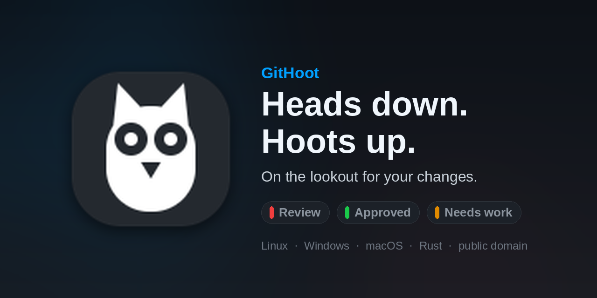

# GitHoot

An owl in your system tray, on the lookout for your changes on GitHub and GitLab. It lights up when
something needs you, and hoots once when it is news.

[Download the latest release](https://github.com/HerrDerb/githoot/releases/latest) ·
[Source on GitHub](https://github.com/HerrDerb/githoot)

## Docs

| | |
|---|---|
| [Icons](icons.md) | Every mark, why the geometry is what it is, what combines |
| [Startup](startup.md) | The one first-run question, what it writes on each platform, and how to undo it |
| [Menu and settings](menu-and-settings.md) | All menu entries and all config keys |
| [PR status](pr-status.md) | The three queries, the GraphQL rationale, the GitHub App |
| [Portals](portals.md) | The seam GitHub and GitLab sit behind, and what Bitbucket will have to bring to it |
| [The PR page](pr-page.md) | What the menu entries open, why it is served locally, and what guards it |
| [The local API](local-api.md) | Serving the judged lists as JSON to your own scripts, off by default |
| [Agents](agents.md) | Starting a coding agent for each pull request that needs you. Off until switched on |
| [The hoot](hoot.md) | Exactly which transitions make a sound, and which stay quiet |
| [Troubleshooting](troubleshooting.md) | Tooltip meanings, the log, the Defender verdict |
| [Updates and releases](updates-and-releases.md) | Verification, recovery, immutable releases, signing keys |
| [Privacy policy](privacy.md) | Every connection GitHoot makes and every file it writes |
